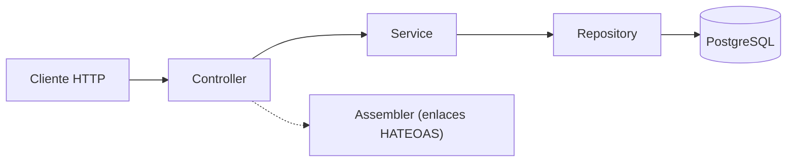
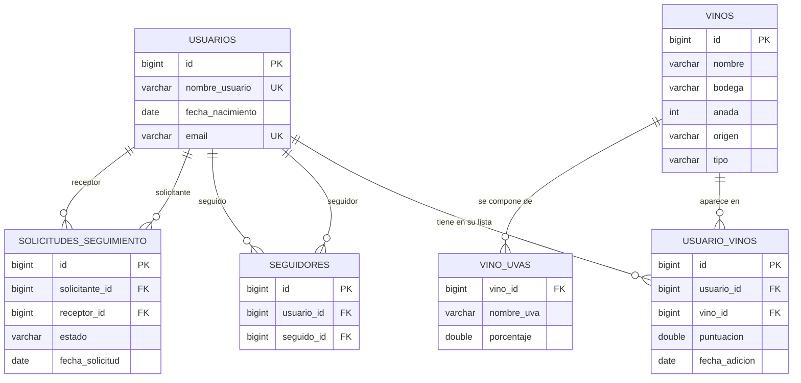

# Wine Community API

API REST para una comunidad online de gestión y recomendación de vinos, desarrollada con Spring Boot. Los usuarios pueden construir su propia lista de vinos puntuados, seguirse entre sí mediante solicitudes de seguimiento, consultar estadísticas de sus puntuaciones y recibir recomendaciones personalizadas.

## Índice

- [Descripción](#descripción)
- [Funcionalidades](#funcionalidades)
- [Tecnologías](#tecnologías)
- [Arquitectura](#arquitectura)
- [Modelo de datos](#modelo-de-datos)
- [Diseño de la API](#diseño-de-la-api)
- [Decisiones de diseño](#decisiones-de-diseño)
- [Instalación y ejecución](#instalación-y-ejecución)

## Descripción

El servicio simula el backend de una red social de aficionados al vino. Cada usuario mantiene una lista personal de vinos, a cada uno de los cuales asigna una puntuación de 0 a 10. Los usuarios pueden buscarse entre ellos, solicitar seguirse, aceptar o rechazar las solicitudes recibidas y consultar los vinos de las personas a las que siguen. A partir de toda esa información, la API calcula recomendaciones personalizadas y estadísticas de puntuación.

El flujo de uso habitual es el siguiente:

1. Se dan de alta los usuarios de la comunidad.
2. Cada usuario añade vinos a su lista y los puntúa.
3. Un usuario solicita seguir a otro y el destinatario acepta o rechaza la solicitud.
4. Una vez establecido el seguimiento, el usuario puede consultar los vinos de las personas a las que sigue y recibe recomendaciones basadas en los mejores vinos de esos usuarios.

El diseño sigue los siguientes principios REST:

- **Recursos identificados por URI**, organizados de forma jerárquica (por ejemplo, `/usuarios/{usuarioId}/vinos`).
- **Interfaz uniforme de HTTP**: `GET`, `POST`, `PUT` y `DELETE` con sus códigos de estado correspondientes (`200`, `201`, `204`, `400`, `404`).
- **Navegabilidad (HATEOAS)**: las respuestas incluyen enlaces a los recursos relacionados, de modo que el cliente puede recorrer la API sin conocer de antemano su estructura.
- **Paginación y filtrado** en todos los listados, mediante parámetros de consulta.
- **Persistencia** de los datos en una base de datos relacional PostgreSQL.

La autenticación y la autorización quedan fuera del alcance de este trabajo. Se asumen ya resueltas.

## Funcionalidades

### Usuarios

- **Alta de un usuario.** Se indican nombre de usuario, fecha de nacimiento y correo electrónico (el nombre de usuario y el correo son únicos). La edad se calcula a partir de la fecha de nacimiento: si el usuario es menor de 18 años, el alta se rechaza con un `400` y el mensaje `El usuario debe ser mayor de edad`.
- **Consulta de los datos básicos** de un usuario. La respuesta incluye enlaces a sus recursos relacionados (vinos, seguidos y solicitudes).
- **Modificación** del nombre de usuario, la fecha de nacimiento y el correo.
- **Borrado** del perfil.
- **Listado de todos los usuarios**, paginado y con filtro opcional por patrón de nombre (por ejemplo, todos los usuarios cuyo nombre contiene `Mar`).

### Lista de vinos de un usuario

- **Añadir un vino a la lista.** Se envía el vino completo (nombre, bodega, añada, origen, tipo y composición de uvas en porcentaje) junto con una puntuación de 0 a 10. La fecha de adición se registra automáticamente.
- **Modificar la puntuación** de un vino de la lista.
- **Eliminar un vino** de la lista.
- **Listar los vinos del usuario**, paginados y con filtros opcionales: rango de fechas de adición, tipo, bodega, origen, añada y uva. Los filtros de fechas, tipo, bodega, origen y añada se pueden combinar entre sí.

### Seguimiento entre usuarios

- **Enviar una solicitud de seguimiento.** El seguimiento no es inmediato: se crea una solicitud en estado pendiente que el destinatario debe aceptar o rechazar.
- **Consultar las solicitudes pendientes** recibidas, con paginación.
- **Aceptar o rechazar** una solicitud. Al aceptarla se establece la relación de seguimiento; al rechazarla no (véase [Aceptar y rechazar una solicitud de seguimiento](#aceptar-y-rechazar-una-solicitud-de-seguimiento)).
- **Listar los usuarios a los que se sigue**, con paginación y filtro opcional por nombre.
- **Dejar de seguir** a un usuario.
- **Consultar los vinos de un usuario seguido**, con los mismos filtros que en la lista propia.

### Recomendaciones y estadísticas

- **Recomendaciones personalizadas**: datos del usuario, sus 5 últimos vinos añadidos, sus 5 vinos mejor puntuados y los 5 mejores vinos de los usuarios a los que sigue.
- **Estadísticas**: nota media de los vinos puntuados, con filtros opcionales por fechas, tipo, bodega, origen y añada.

## Tecnologías

| Tecnología | Uso |
|---|---|
| Java 17 | Lenguaje |
| Spring Boot 4.0.5 | Framework base |
| Spring Web MVC | Controladores REST |
| Spring Data JPA (Hibernate) | Acceso a datos y mapeo objeto-relacional |
| Spring HATEOAS | Enlaces de navegación y paginación |
| PostgreSQL | Base de datos |
| Lombok | Reducción de código repetitivo |
| Maven (con wrapper) | Gestión de dependencias y construcción |
| Postman | Pruebas manuales de la API |

## Arquitectura

La aplicación sigue una arquitectura en capas, en la que cada capa solo conoce a la inmediatamente inferior:



| Capa | Responsabilidad |
|---|---|
| `controller` | Expone los endpoints REST, recibe las peticiones y construye las respuestas HTTP (códigos de estado y cabecera `Location`). |
| `assembler` | Añade los enlaces HATEOAS a las representaciones y construye las respuestas paginadas con sus enlaces de navegación. |
| `service` | Contiene la lógica de negocio (por ejemplo, la comprobación de mayoría de edad o la creación de la relación de seguimiento al aceptar una solicitud). |
| `repository` | Interfaces de Spring Data JPA para acceder a la base de datos, con consultas derivadas del nombre del método y consultas `@Query`. |
| `model` | Entidades JPA que se corresponden con las tablas. |

Como ejemplo, esto es lo que ocurre con la petición `GET /usuarios/1/vinos?tipo=Tinto`:

1. El **controlador** recibe la petición y lee el identificador del usuario y los parámetros de consulta (filtros y paginación).
2. Llama al **servicio**, que comprueba que el usuario existe y pide los datos al repositorio.
3. El **repositorio** ejecuta una única consulta paginada con los filtros indicados.
4. El **assembler** añade a cada elemento de la página su enlace `self` y los enlaces de navegación (`first`, `prev`, `next`, `last`).
5. El controlador devuelve la respuesta con el código `200 OK`.

### Estructura del proyecto

```
winecommunity/
├── .gitattributes
├── .gitignore
├── pom.xml
├── mvnw
├── mvnw.cmd
├── .mvn/wrapper
│   └── maven-wrapper.properties
└── src/
    ├── main/
    │   ├── java/com/sos/winecommunity/
    │   │   ├── WinecommunityApplication.java
    │   │   ├── assembler/
    │   │   │   ├── UsuarioModelAssembler.java
    │   │   │   ├── UsuarioVinoModelAssembler.java
    │   │   │   └── SolicitudSeguimientoModelAssembler.java
    │   │   ├── controller/
    │   │   │   ├── UsuarioControlador.java
    │   │   │   ├── UsuarioVinoControlador.java
    │   │   │   ├── SeguimientoControlador.java
    │   │   │   └── SolicitudSeguimientoControlador.java
    │   │   ├── model/
    │   │   │   ├── Usuario.java
    │   │   │   ├── Vino.java
    │   │   │   ├── PorcentajeUva.java
    │   │   │   ├── UsuarioVino.java
    │   │   │   ├── Seguimiento.java
    │   │   │   └── SolicitudSeguimiento.java
    │   │   ├── repository/
    │   │   │   ├── UsuarioRepository.java
    │   │   │   ├── VinoRepository.java
    │   │   │   ├── UsuarioVinoRepository.java
    │   │   │   ├── SeguimientoRepository.java
    │   │   │   └── SolicitudSeguimientoRepository.java
    │   │   └── service/
    │   │       ├── UsuarioServicio.java
    │   │       ├── UsuarioVinoServicio.java
    │   │       ├── SeguimientoServicio.java
    │   │       └── SolicitudSeguimientoServicio.java
    │   └── resources/
    │       └── application.properties
    └── test/
        └── java/com/sos/winecommunity/WinecommunityApplicationTests.java
```

## Modelo de datos

Las tablas se generan automáticamente a partir de las entidades al arrancar la aplicación (`spring.jpa.hibernate.ddl-auto=update`).



- **`usuarios`**: datos básicos de cada usuario. El nombre de usuario y el correo son únicos.
- **`vinos`** y **`vino_uvas`**: un vino se describe por nombre, bodega, añada, origen (país o región) y tipo (tinto, blanco, rosado...). Su composición se guarda en `vino_uvas`, con una fila por variedad de uva y su porcentaje, ya que un vino puede estar formado por varias.
- **`usuario_vinos`**: relación entre un usuario y un vino de su lista. Es una entidad propia porque guarda datos de la relación: la puntuación y la fecha de adición.
- **`solicitudes_seguimiento`**: solicitudes de seguimiento con su estado (`PENDIENTE`, `ACEPTADA` o `RECHAZADA`). En `solicitante_id` se guarda quien quiere seguir y en `receptor_id` quien recibe la solicitud.
- **`seguidores`**: relaciones de seguimiento ya establecidas. En la columna `usuario_id` se guarda el seguidor y en `seguido_id` el usuario seguido. Se inserta una fila cuando se acepta una solicitud.

Se separan las solicitudes de las relaciones consolidadas porque son conceptos distintos: una solicitud tiene ciclo de vida (pendiente, aceptada, rechazada) y una relación de seguimiento solo existe una vez aceptada.

## Diseño de la API

### Recursos

| Recurso | Tipo | URI |
|---|---|---|
| Usuarios | Colección | `/usuarios` |
| Usuario | Elemento | `/usuarios/{usuarioId}` |
| Vinos de un usuario | Subcolección | `/usuarios/{usuarioId}/vinos` |
| Estadísticas de un usuario | Recurso compuesto | `/usuarios/{usuarioId}/vinos/estadisticas` |
| Recomendaciones de un usuario | Recurso compuesto | `/usuarios/{usuarioId}/vinos/recomendaciones` |
| Solicitudes de seguimiento | Subcolección | `/usuarios/{usuarioId}/solicitudes` |
| Usuarios seguidos | Subcolección | `/usuarios/{usuarioId}/seguidos` |

Las operaciones de aceptar y rechazar una solicitud, así como la modificación de la puntuación, se expresan con un segmento de verbo o de atributo en la URI (`/aceptar`, `/rechazar`, `/puntuacion`), siguiendo el enfoque de "tunneling".

### Endpoints

**Usuarios**

| Método | URI | Descripción | Respuestas |
|---|---|---|---|
| `POST` | `/usuarios` | Da de alta un usuario. Cuerpo: JSON con nombre de usuario, fecha de nacimiento y correo. | `201` con cabecera `Location`; `400` si es menor de edad |
| `GET` | `/usuarios` | Lista los usuarios paginados. Parámetros: `nombre`, `page`, `size`. | `200`; `404` si no hay resultados |
| `GET` | `/usuarios/{usuarioId}` | Devuelve los datos de un usuario. | `200`; `404` |
| `PUT` | `/usuarios/{usuarioId}` | Modifica los datos del usuario. Cuerpo: JSON con los nuevos datos. | `200`; `404` |
| `DELETE` | `/usuarios/{usuarioId}` | Borra un usuario. | `204`; `404` |

**Vinos de un usuario**

| Método | URI | Descripción | Respuestas |
|---|---|---|---|
| `POST` | `/usuarios/{usuarioId}/vinos?puntuacion=` | Añade un vino a la lista con una puntuación. Cuerpo: JSON con el vino. | `201` con cabecera `Location`; `404` si el usuario no existe |
| `GET` | `/usuarios/{usuarioId}/vinos` | Lista los vinos del usuario. Parámetros: `desde`, `hasta`, `tipo`, `bodega`, `origen`, `anada`, `uva`, `page`, `size`. | `200` |
| `PUT` | `/usuarios/{usuarioId}/vinos/{usuarioVinoId}/puntuacion?puntuacion=` | Modifica la puntuación de un vino de la lista (véase [Modificar la puntuación de un vino](#modificar-la-puntuación-de-un-vino)). | `200`; `404` |
| `DELETE` | `/usuarios/{usuarioId}/vinos/{usuarioVinoId}` | Elimina un vino de la lista. | `204`; `404` |
| `GET` | `/usuarios/{usuarioId}/vinos/estadisticas` | Nota media de los vinos del usuario. Parámetros: `desde`, `hasta`, `tipo`, `bodega`, `origen`, `anada`. | `200` |
| `GET` | `/usuarios/{usuarioId}/vinos/recomendaciones` | Recomendaciones personalizadas. | `200`; `404` |

**Seguimiento**

| Método | URI | Descripción | Respuestas |
|---|---|---|---|
| `POST` | `/usuarios/{usuarioId}/solicitudes` | El usuario `{usuarioId}` solicita seguir a otro. Cuerpo: `{"seguidoId": 2}`. | `201` con cabecera `Location`; `404` |
| `GET` | `/usuarios/{usuarioId}/solicitudes` | Lista las solicitudes pendientes recibidas por el usuario. Parámetros: `page`, `size`. | `200` |
| `PUT` | `/usuarios/{usuarioId}/solicitudes/{solicitudId}/aceptar` | Acepta una solicitud y crea la relación de seguimiento (véase [Aceptar y rechazar una solicitud de seguimiento](#aceptar-y-rechazar-una-solicitud-de-seguimiento)). | `200`; `404` |
| `PUT` | `/usuarios/{usuarioId}/solicitudes/{solicitudId}/rechazar` | Rechaza una solicitud sin crear ninguna relación. | `200`; `404` |
| `GET` | `/usuarios/{usuarioId}/seguidos` | Lista los usuarios a los que sigue. Parámetros: `nombre`, `page`, `size`. | `200` |
| `DELETE` | `/usuarios/{usuarioId}/seguidos/{seguidoId}` | Deja de seguir a un usuario. | `204` |
| `GET` | `/usuarios/{usuarioId}/seguidos/{seguidoId}/vinos` | Lista los vinos de un usuario seguido, con los mismos filtros que la lista propia. | `200` |

### Parámetros de consulta

Todos los parámetros de consulta son opcionales.

| Parámetro | Disponible en | Descripción | Ejemplo |
|---|---|---|---|
| `page` | Todos los listados | Número de página, empezando en 0. Por defecto, `0`. | `/usuarios?page=1&size=5` |
| `size` | Todos los listados | Número de elementos por página. Por defecto, `10`. | `/usuarios?size=3` |
| `nombre` | Usuarios y seguidos | Devuelve los usuarios cuyo nombre contiene el texto indicado. Distingue mayúsculas y minúsculas. | `/usuarios?nombre=mar` |
| `desde` | Vinos, vinos de un seguido y estadísticas | Fecha de adición mínima (incluida), en formato `aaaa-mm-dd`. | `/usuarios/1/vinos?desde=2026-01-01` |
| `hasta` | Vinos, vinos de un seguido y estadísticas | Fecha de adición máxima (incluida), en formato `aaaa-mm-dd`. | `/usuarios/1/vinos?hasta=2026-12-31` |
| `tipo` | Vinos, vinos de un seguido y estadísticas | Tipo de vino. No distingue mayúsculas. | `/usuarios/1/vinos?tipo=Tinto` |
| `bodega` | Vinos, vinos de un seguido y estadísticas | Bodega del vino. No distingue mayúsculas. | `/usuarios/1/vinos?bodega=Vega%20Sicilia` |
| `origen` | Vinos, vinos de un seguido y estadísticas | País o región de origen. No distingue mayúsculas. | `/usuarios/1/vinos?origen=Ribera%20del%20Duero` |
| `anada` | Vinos, vinos de un seguido y estadísticas | Año de la añada. | `/usuarios/1/vinos?anada=2015` |
| `uva` | Vinos y vinos de un seguido | Vinos que contienen esa variedad de uva. No distingue mayúsculas. | `/usuarios/1/vinos?uva=Tempranillo` |
| `puntuacion` | Añadir vino y modificar puntuación | Puntuación del vino, de 0 a 10. Los decimales se escriben con punto. | `/usuarios/1/vinos?puntuacion=8.5` |

Los espacios de los valores se escriben como `%20` en la URL (Postman lo hace automáticamente). Algunos ejemplos de uso:

- **Paginar**: `GET /usuarios?page=1&size=5` devuelve la segunda página con 5 usuarios por página.
- **Buscar por nombre**: `GET /usuarios?nombre=Mar` devuelve los usuarios cuyo nombre contiene `Mar` (por ejemplo, `Mario` o `Maria`).
- **Filtrar por fechas**: `GET /usuarios/1/vinos?desde=2026-01-01&hasta=2026-12-31` devuelve los vinos que el usuario añadió durante 2026.
- **Combinar filtros**: `GET /usuarios/1/vinos?tipo=Tinto&anada=2015&bodega=Vega%20Sicilia` devuelve los vinos tintos de 2015 de esa bodega.
- **Filtros y paginación a la vez**: `GET /usuarios/1/vinos?origen=Rioja&page=0&size=5`.
- **Estadísticas con filtros**: `GET /usuarios/1/vinos/estadisticas?tipo=Tinto&desde=2026-01-01` calcula la nota media solo de los tintos añadidos desde esa fecha.
- **Filtrar por uva**: `GET /usuarios/1/vinos?uva=Tempranillo`. El filtro por uva se aplica de forma independiente: cuando se indica, se devuelven los vinos que contienen esa variedad sin tener en cuenta el resto de filtros.

### Operaciones destacadas

#### Aceptar y rechazar una solicitud de seguimiento

Seguir a otro usuario **no es inmediato**. Enviar una solicitud (`POST /usuarios/{usuarioId}/solicitudes`) solo crea una solicitud en estado `PENDIENTE`. La relación de seguimiento no existe hasta que el usuario destinatario la acepta.

El proceso completo, con dos usuarios, mario123 (id 1) y ana456 (id 2), es el siguiente:

1. **Mario solicita seguir a Ana**: `POST /usuarios/1/solicitudes` con el cuerpo `{"seguidoId": 2}`.
2. **Ana consulta sus solicitudes pendientes**: `GET /usuarios/2/solicitudes`. Cada solicitud incluye su `id`, el solicitante y el receptor.
3. **Ana decide** usando el `id` de la solicitud: la acepta (`PUT /usuarios/2/solicitudes/{solicitudId}/aceptar`) o la rechaza (`PUT /usuarios/2/solicitudes/{solicitudId}/rechazar`).

| | Aceptar | Rechazar |
|---|---|---|
| **Método y URI** | `PUT /usuarios/{usuarioId}/solicitudes/{solicitudId}/aceptar` | `PUT /usuarios/{usuarioId}/solicitudes/{solicitudId}/rechazar` |
| **`{usuarioId}`** | Usuario que recibió la solicitud (el que va a ser seguido) | Usuario que recibió la solicitud |
| **`{solicitudId}`** | Identificador de la solicitud, que se obtiene en el listado de solicitudes pendientes | Identificador de la solicitud |
| **Cuerpo de la petición** | Ninguno | Ninguno |
| **Efecto sobre la solicitud** | El estado pasa a `ACEPTADA` | El estado pasa a `RECHAZADA` |
| **Efecto sobre el seguimiento** | Se crea la relación: el solicitante pasa a seguir al receptor (nueva fila en `seguidores`) | No se crea ninguna relación |
| **Respuesta correcta** | `200 OK` con la solicitud actualizada | `200 OK` con la solicitud actualizada |
| **Respuesta de error** | `404 Not Found` si la solicitud no existe | `404 Not Found` si la solicitud no existe |

Algunas consideraciones:

- Solo se listan las solicitudes en estado `PENDIENTE`, de modo que una solicitud aceptada o rechazada deja de aparecer en `GET /usuarios/{usuarioId}/solicitudes`.
- Tras aceptar, el solicitante ve al receptor en su lista de seguidos (`GET /usuarios/{solicitanteId}/seguidos`) y puede consultar sus vinos (`GET /usuarios/{solicitanteId}/seguidos/{receptorId}/vinos`).
- Aceptar y rechazar se modelan como `PUT` sobre una URI con el verbo de la operación.

#### Modificar la puntuación de un vino

```
PUT /usuarios/{usuarioId}/vinos/{usuarioVinoId}/puntuacion?puntuacion=9.5
```

- **`{usuarioVinoId}`** es el identificador de la **entrada de la lista** del usuario (el campo `id` de cada elemento devuelto por `GET /usuarios/{usuarioId}/vinos`), no el identificador del vino (`vino.id`). Esto es así porque la puntuación pertenece a la relación entre el usuario y el vino: el mismo vino puede estar en las listas de varios usuarios, cada uno con su propia puntuación.
- **`puntuacion`** es un parámetro de consulta con la nueva nota, de 0 a 10. Los decimales se escriben con punto (`9.5`).
- La petición **no lleva cuerpo**.
- Solo cambia la puntuación: la fecha de adición y los datos del vino no se modifican.
- Responde `200 OK` con la entrada actualizada, o `404 Not Found` si no existe.
- El cambio se refleja inmediatamente en las [estadísticas](#estadísticas-de-puntuaciones) y en las [recomendaciones](#recomendaciones-personalizadas).

#### Recomendaciones personalizadas

```
GET /usuarios/{usuarioId}/vinos/recomendaciones
```

Devuelve en una sola respuesta:

| Campo | Contenido |
|---|---|
| `usuario` | Datos básicos del usuario. |
| `ultimosVinos` | Sus 5 últimos vinos añadidos (los de fecha de adición más reciente). |
| `topVinos` | Sus 5 vinos con mayor puntuación. |
| `topVinosAmigos` | Los 5 vinos con mayor puntuación entre todos los usuarios a los que sigue. |

Si el usuario aún no sigue a nadie, `topVinosAmigos` es una lista vacía.

#### Estadísticas de puntuaciones

```
GET /usuarios/{usuarioId}/vinos/estadisticas
```

Devuelve un único número: la **nota media** de los vinos puntuados por el usuario. Admite los filtros `desde`, `hasta`, `tipo`, `bodega`, `origen` y `anada`, que se pueden combinar. Si ningún vino cumple los filtros, la respuesta es `0.0`.

### Formato de los datos

**Usuario**

```json
{
    "nombreUsuario": "mario123",
    "fechaNacimiento": "1995-06-15",
    "email": "mario@email.com"
}
```

**Vino** (el porcentaje de cada uva se expresa sobre 100)

```json
{
    "nombre": "Vega Sicilia Único",
    "bodega": "Vega Sicilia",
    "anada": 2015,
    "origen": "Ribera del Duero",
    "tipo": "Tinto",
    "uvas": [
        { "nombreUva": "Tempranillo", "porcentaje": 85.0 },
        { "nombreUva": "Cabernet Sauvignon", "porcentaje": 15.0 }
    ]
}
```

**Solicitud de seguimiento** (cuerpo de la petición `POST /usuarios/{usuarioId}/solicitudes`)

```json
{
    "seguidoId": 2
}
```

### Navegabilidad (HATEOAS) y paginación

Cada usuario devuelto incluye enlaces a sus recursos relacionados:

```json
{
    "_links": {
        "self":        { "href": "http://localhost:8080/usuarios/1" },
        "vinos":       { "href": "http://localhost:8080/usuarios/1/vinos?page=0&size=10{&desde,hasta,tipo,bodega,origen,anada,uva}", "templated": true },
        "seguidos":    { "href": "http://localhost:8080/usuarios/1/seguidos?page=0&size=10{&nombre}", "templated": true },
        "solicitudes": { "href": "http://localhost:8080/usuarios/1/solicitudes?page=0&size=10" }
    },
    "email": "mario@email.com",
    "fechaNacimiento": "1995-06-15",
    "id": 1,
    "nombreUsuario": "mario123"
}
```

Los enlaces marcados como `templated` incluyen entre llaves los parámetros opcionales que admite el recurso.

Los listados devuelven una respuesta paginada con tres bloques: `_embedded` (los elementos de la página, cada uno con su propio enlace `self`), `_links` (enlaces de navegación) y `page` (metadatos de la paginación):

```json
{
    "_embedded": { "usuarioList": [ ... ] },
    "_links": {
        "self": { "href": "http://localhost:8080/usuarios?page=0&size=10" }
    },
    "page": { "number": 0, "size": 10, "totalElements": 1, "totalPages": 1 }
}
```

Además de `self`, el servicio genera los enlaces `first`, `prev`, `next` y `last`. Estos últimos solo aparecen cuando hay más de una página, de modo que el cliente puede recorrer el listado siguiendo los enlaces sin construir las URL por su cuenta. Si una página no tiene elementos, el bloque `_embedded` no aparece.

Los enlaces se construyen en los **assemblers** (`RepresentationModelAssemblerSupport`), y las entidades que se devuelven extienden `RepresentationModel`. Las páginas se convierten en modelos con enlaces mediante `PagedResourcesAssembler`.

### Códigos de respuesta

| Código | Cuándo se devuelve |
|---|---|
| `200 OK` | Consulta o modificación correcta. |
| `201 Created` | Recurso creado (usuario, vino en la lista o solicitud de seguimiento). Incluye la cabecera `Location` y no lleva cuerpo. |
| `204 No Content` | Borrado correcto (usuario, vino de la lista o seguimiento). |
| `400 Bad Request` | Alta de un usuario menor de edad. El cuerpo contiene el mensaje de error. |
| `404 Not Found` | El recurso solicitado no existe (usuario, vino de la lista o solicitud), o un listado de usuarios no devuelve resultados. |

## Decisiones de diseño

- **Las respuestas a `POST` no llevan cuerpo.** Se devuelve `201 Created` con la cabecera `Location` apuntando al recurso, o a la colección en la que se ha creado.
- **El seguimiento se modela en dos entidades.** La solicitud (`SolicitudSeguimiento`) tiene un estado y un ciclo de vida; la relación consolidada (`Seguimiento`) solo se crea al aceptar la solicitud. Rechazar una solicitud no deja ninguna relación.
- **Aceptar, rechazar y puntuar como `PUT` con verbo en la URI.** Cumplen el enfoque de "tunneling" y dejan claro en la URL qué operación se realiza sobre el recurso.
- **Filtros dinámicos con `@Query`.** Con seis filtros opcionales y combinables, escribir un método derivado por cada combinación sería inviable. Se usa una consulta con parámetros opcionales (`:param IS NULL OR ...`) que resuelve todas las combinaciones en una sola. Para que PostgreSQL pueda inferir el tipo de los parámetros nulos se utiliza `CAST` explícito, y en el listado de vinos las fechas ausentes se sustituyen en el servicio por un rango por defecto (del `1900-01-01` al `9999-12-31`).
- **Filtrado y paginación en la base de datos**, no en memoria, mediante `Pageable` y consultas en el repositorio.
- **Controladores y servicios separados por responsabilidad.** Las solicitudes de seguimiento y los usuarios seguidos tienen cada uno su controlador y su servicio.
- **Recomendaciones como recurso compuesto.** Agrupan datos de varias entidades (usuario, últimos vinos, mejores vinos propios y mejores vinos de los seguidos) sin una entidad propia, y se construyen en el controlador.
- **Gestión de errores en los controladores.** Las excepciones del servicio se traducen a `404` o `400` con `try/catch`.

## Instalación y ejecución

Las instrucciones de instalación y ejecución están en [INSTALACION.md](INSTALACION.md), junto con una prueba guiada completa, con la respuesta de cada operación (vinos, puntuaciones, seguimiento, recomendaciones...).
